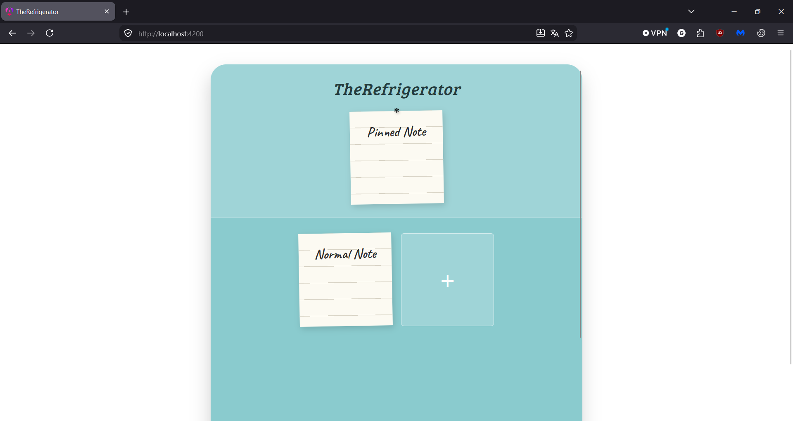
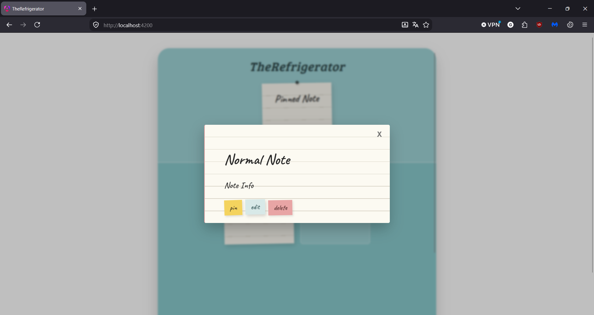
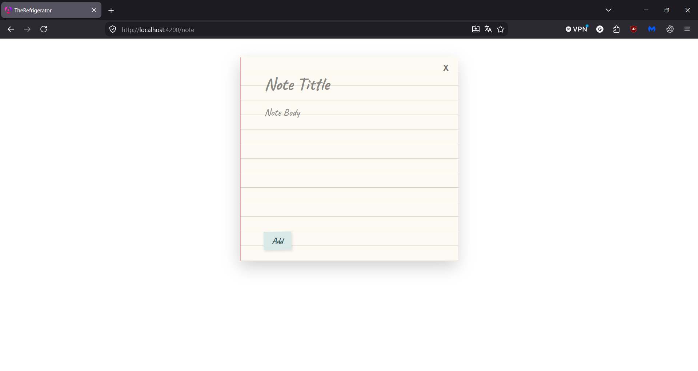

# The Refrigerator  
Aplicación web de bloc de notas con interfaz temática inspirada en un refrigerador. 

## Tecnologías
 - Frontend: Angular (TypeScript, HTML, CSS).
 - Backend: ASP.NET Core, C#, Entity Framework, SQL Server.
 - Autenticacion: JWT

 ## v2.0
 - Registro e Inicio de Sesión de Usuarios.
 - Autenticaión JWT.
 - Crear, Editar, Fijar y Eliminar Notas.
 - Persistencia de Datos SQL Server.
 - Comunicación Angular + .NET.
 - Protección de Endpoints.

 ## Vista Previa

 
 
 

